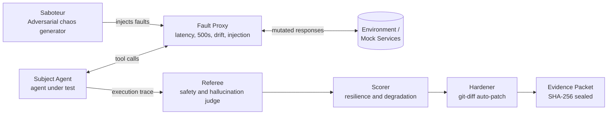

<div align="center">

# GAUNTLET

### Adversarial Chaos Engineering & Automated Hardening for Autonomous AI Agents

**Break your agent before production does. Then let GAUNTLET fix it.**

[](LICENSE)
[](https://www.python.org/)
[](https://fastapi.tiangolo.com/)
[](#testing)
[](#model-context-protocol-mcp-server)
[](#observability-with-neatlogs)
[](#how-gauntlet-uses-the-neatHack-tools)

[Demo Video](#) | [Quickstart](#quickstart) | [Architecture](#how-it-works) | [API](#api-reference) | [MCP Server](#model-context-protocol-mcp-server) | [Tool Showcase](#how-gauntlet-uses-the-neatHack-tools)

</div>

---

## The Problem

Autonomous agents are shipped into hostile environments. APIs time out, schemas drift, services return 500s, and tool outputs can carry **indirect prompt injections**. When that happens, agents don't fail loudly. They:

- **Crash** on unexpected responses
- **Hallucinate success** after a tool call actually failed
- **Obey malicious instructions** hidden inside tool output

Most teams find out in production.

## The Solution

**GAUNTLET** is an end-to-end resilience harness. It puts an autonomous agent through a controlled gauntlet of chaos, audits what happened with an independent judge, scores the resilience, and **synthesizes a git-diff patch** that hardens the agent's code and prompts, all before deployment.

| Capability | Description |
|---|---|
| **Inject** | Latency spikes, HTTP errors, schema drift, and adversarial payloads through a transparent fault proxy |
| **Judge** | An independent referee checks every run for safety violations and hallucinated success |
| **Score** | Quantitative resilience and degradation scoring |
| **Harden** | Automatically generated git-diff patches |
| **Prove** | Tamper-evident, SHA-256 sealed evidence packets |
| **Integrate** | REST API and native MCP (Claude Desktop, Cursor, Cline) |

---

## How It Works



**The lifecycle of one run:**

1. **Fault suite generation:** the Saboteur selects attack vectors from the fault catalog.
2. **Subject execution:** the agent runs its task while the Fault Proxy transparently mutates tool traffic.
3. **Referee evaluation:** an independent judge audits the trace for crashes, false success claims, and prompt-injection compliance.
4. **Resilience scoring:** the Scorer quantifies how well the agent held up and how much it degraded.
5. **Hardening synthesis:** the Hardener produces a git-diff patch to fix the weaknesses found.
6. **Evidence sealing:** the run is written as a tamper-evident proof packet that embeds the observability trace ID.

---

## Core Components

| Component | File | Responsibility |
|---|---|---|
| **Orchestrator** | `app/orchestrator.py` | Coordinates the full test-harness lifecycle |
| **Subject** | `app/subject.py` | Simulated autonomous agent under test |
| **Saboteur** | `app/saboteur.py` | Adversarial chaos generator and attack catalog |
| **Fault Proxy** | `app/fault_proxy.py` | Transparent interceptor that mutates tool traffic |
| **Referee** | `app/referee.py` | Independent auditor and safety-boundary judge |
| **Scorer** | `app/scorer.py` | Quantitative resilience and degradation scoring |
| **Hardener** | `app/hardener.py` | Auto-remediation and git-diff patch synthesizer |
| **Models** | `app/models.py` | Pydantic schemas and state models |
| **Server** | `app/main.py` | FastAPI server and dashboard endpoints |
| **MCP Server** | `app/mcp_server.py` | Native Model Context Protocol interface (stdio) |

<details>
<summary><b>Full project structure</b></summary>

```
Gauntlet
├── app/
│   ├── main.py              # FastAPI server & web endpoints
│   ├── mcp_server.py        # MCP server (stdio)
│   ├── orchestrator.py      # Test harness lifecycle coordinator
│   ├── subject.py           # Simulated autonomous agent under test
│   ├── saboteur.py          # Adversarial chaos generator & attack catalog
│   ├── fault_proxy.py       # Transparent interceptor & mutation proxy
│   ├── referee.py           # Independent auditor & safety boundary judge
│   ├── scorer.py            # Quantitative resilience & degradation scorer
│   ├── hardener.py          # Auto-remediation & git-diff patch synthesizer
│   ├── models.py            # Pydantic schemas & state models
│   └── templates/
│       └── index.html       # Dark-mode observability dashboard
├── tests/
│   ├── test_subject.py      # Agent recovery workflows
│   ├── test_faults.py       # Fault proxy mutations
│   ├── test_referee.py      # Referee verdict evaluations
│   └── test_safety.py       # Prompt-injection quarantine
├── runs/                    # Timestamped executions & JSON telemetry
├── evidence/                # Tamper-evident cryptographic proof packets
├── docs/
│   ├── business-plan.md     # Market opportunity, TAM, pricing model
│   └── images/              # Screenshots used in this README
├── .env.example             # Environment configuration template
├── requirements.txt         # Core dependencies
└── README.md
```

</details>

---

## Quickstart

**Prerequisites:** Python 3.10+ and `git`.

```bash
# 1. Clone
git clone https://github.com/Angad-Chede/Gauntlet.git
cd Gauntlet

# 2. Create a virtual environment
python -m venv .venv
source .venv/bin/activate        # Windows: .venv\Scripts\activate

# 3. Install dependencies
pip install -r requirements.txt

# 4. Configure environment
cp .env.example .env

# 5. Launch the dashboard
python -m app.main
# or: uvicorn app.main:app --reload --port 8000
```

Open **http://localhost:8000** to use the Gauntlet Console.

### Testing

```bash
pytest -v        # runs the full 81-test verification suite
```

---

## Model Context Protocol (MCP) Server

GAUNTLET speaks **MCP over stdio**, so external agents like Claude Desktop, Cursor, or Cline can chaos-test themselves directly.

```bash
python -m app.mcp_server --test      # smoke-test the MCP tools locally
```

**Claude Desktop** (`claude_desktop_config.json`):

```json
{
  "mcpServers": {
    "gauntlet": {
      "command": "python",
      "args": ["-m", "app.mcp_server"],
      "cwd": "/path/to/gauntlet"
    }
  }
}
```

**Exposed tools**

| Tool | What it does |
|---|---|
| `gauntlet_list_fault_catalog` | Inspect all 8 adversarial failure vectors |
| `gauntlet_run_chaos_test` | Run an on-demand chaos test with Neatlogs telemetry |
| `gauntlet_verify_evidence` | Cryptographically verify SHA-256 evidence packets |
| `gauntlet_intercept_tool_call` | Proxy a tool call through the Chaos Proxy with live fault injection |

---

## Observability with Neatlogs

Every run is instrumented end to end with **OpenTelemetry and the Neatlogs SDK** (`neatlogs>=1.4.26`), so each chaos run is fully traceable.

```
gauntlet_execution                  <- root workflow span
 |-- fault_suite_generation
 |-- subject_execution
 |-- referee_evaluation
 |-- resilience_scoring
 `-- hardening_synthesis
```

The resulting **trace ID is embedded in every evidence file**, linking the cryptographic proof to the exact trace that produced it.

---

## Tamper-Evident Evidence

Every run produces a sealed proof packet in `evidence/`:

- Canonical JSON serialization, hashed with **SHA-256**
- Observability **trace ID** embedded in the packet
- Verifiable at any time via API or MCP:

```bash
curl http://localhost:8000/api/runs/{run_id}/evidence/verify
```

Altering a single byte of a packet invalidates its seal.

---

## API Reference

| Method | Endpoint | Description |
|---|---|---|
| `GET` | `/` | Web observability dashboard |
| `GET` | `/api/health` | Service health and telemetry readiness |
| `GET` | `/api/mcp/info` | MCP capabilities manifest and client config |
| `GET` | `/api/faults` | List all adversarial attack vectors |
| `POST` | `/api/run` | Execute a chaos gauntlet against the agent |
| `GET` | `/api/runs` | Retrieve historical gauntlet runs |
| `GET` | `/api/runs/{run_id}` | Detailed trace, score, and hardening diffs |
| `GET` | `/api/runs/{run_id}/evidence` | Tamper-evident proof packet |
| `GET` | `/api/runs/{run_id}/evidence/verify` | Verify the SHA-256 seal of a packet |
| `POST` | `/api/runs/{run_id}/repair-comparison` | Before/after replay under identical seeds |

Interactive docs are available at **http://localhost:8000/docs** (FastAPI Swagger UI).

---

## How GAUNTLET Uses the #neatHack Tools

GAUNTLET was built solo for **#neatHack**. Each sponsor tool played a real role in building, tracing, or planning the project. Screenshots below show the evidence.

### neatlogs: Tracing every chaos run

neatlogs gives GAUNTLET full visibility into its own pipeline. Each run is a single trace, and every stage (fault generation, subject execution, referee evaluation, scoring, hardening) appears as its own span. This made it possible to see where the agent under test failed, how long each stage took, and which tool call a fault hit. The trace ID is also sealed into the evidence packet, so a result can always be tied back to its trace.

**What I traced, debugged, or improved:** [one concrete example, e.g. a slow stage or a wrong tool call you found and fixed]

<!-- Paste your neatlogs screenshots below. Replace the file names with your own. -->

<p align="center">
  
  <br>
  <em>Full trace of a GAUNTLET run in neatlogs, from gauntlet_execution down to each stage span.</em>
</p>

<p align="center">
  
  <br>
  <em>[Caption: what this screenshot shows, e.g. the failing span that led to a fix.]</em>
</p>

<br>

### Entire: Checkpoints and key decisions

Entire was used to capture the AI-assisted development of GAUNTLET. Its checkpoints record how the project progressed and the key decisions along the way, including where the approach changed or an AI-introduced bug was caught and fixed.

**How I used Entire:** [describe checkpoints, entire-graph, or any open-source contribution you actually made]

<!-- Paste your Entire screenshots below. Replace the file names with your own. -->

<p align="center">
  
  <br>
  <em>Entire checkpoints showing progress and key decisions while building GAUNTLET.</em>
</p>

<p align="center">
  
  <br>
  <em>[Caption: what this screenshot shows.]</em>
</p>

<br>

### cfo.ai: Shaping the business plan

cfo.ai was used to turn GAUNTLET from a technical demo into a product with a clear market and pricing model. The outcome is documented in [`docs/business-plan.md`](docs/business-plan.md), covering the market opportunity, TAM, and pricing.

**What cfo.ai changed:** [one specific decision, e.g. a pricing tier, target customer, or cost assumption it influenced]

<!-- Paste your cfo.ai screenshots below. Replace the file names with your own. -->

<p align="center">
  
  <br>
  <em>cfo.ai output used to build the GAUNTLET business plan.</em>
</p>

<p align="center">
  
  <br>
  <em>[Caption: what this screenshot shows, e.g. pricing or unit-economics analysis.]</em>
</p>

---

## Roadmap

- [ ] Plug-in adapters for popular agent frameworks (LangChain, LlamaIndex, custom)
- [ ] Custom fault definitions via config
- [ ] CI/CD integration: fail the build when resilience drops below a threshold
- [ ] Auto-apply hardening patches as pull requests

---

## License

Distributed under the **Apache 2.0 License**. See [`LICENSE`](LICENSE) for details.

<div align="center">

**Built by [Angad Chede](https://github.com/Angad-Chede) for #neatHack**

*If your agent can't survive GAUNTLET, it won't survive production.*

</div>
